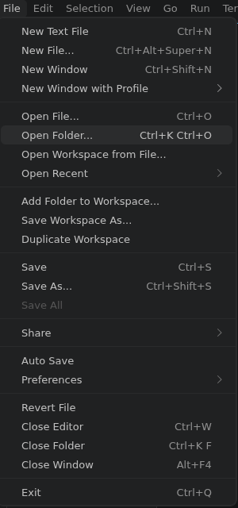
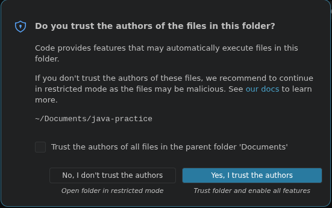
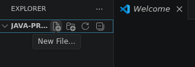
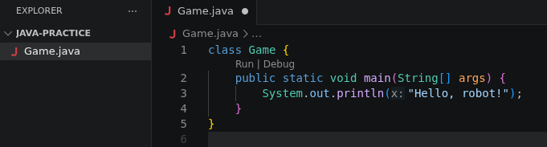
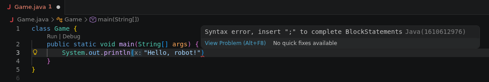
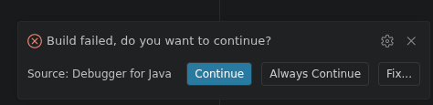

# Your First Program

Robot code comes later. First you need the basics of Java, and we'll learn them by building a small game. Before any of that, though, you need a way to run code, so you can try every example in the coming lessons yourself instead of only reading about it.

We write and run code in a program called **WPILib VS Code**. It works a bit like a word processor for code: you type code into it, and it can run that code for you. If you're on one of the robotics laptops, it's already installed. It's also the same program we use for the real robot code.

On your own computer, you can install it by following [WPILib's install guide](https://docs.wpilib.org/en/stable/docs/zero-to-robot/step-2/wpilib-setup.html).

## Step 1: Open VS Code
Find the desktop icon whose name starts with a year and ends with **WPILib VS Code**, like **2026 WPILib VS Code**, and double-click it.

If it isn't on the desktop, press the Windows key, type `WPILib`, and click the **WPILib VS Code** that comes up.

If there's more than one, pick the newest year. The older ones are left over from past seasons.

The first time it opens, you may get a welcome page. Close it with the **×** on its tab at the top.

## Step 2: Make a folder for your code
VS Code works with folders, so make one to hold all your practice code.
1. At the very top of the window, click **File**, then **Open Folder...**

   

2. A window for picking a folder pops up. On its left side, click **Documents**.
3. Click **New folder** near the top of that window. Name it `java-practice` and press Enter.
4. Click your new `java-practice` folder once, then click **Select Folder** at the bottom.
5. VS Code might ask "Do you trust the authors of the files in this folder?" You made the folder yourself, so click **Yes, I trust the authors**.

   

`JAVA-PRACTICE` now shows up on the left side of VS Code. That side panel lists the files in your folder, and right now it's empty.

## Step 3: Make a file
1. Move your mouse over `JAVA-PRACTICE` on the left. A few small buttons appear next to it.
2. Click the first one, which looks like a page with a **+** on it. (Not sure which one that is? Hold your mouse over a button for a second and it'll tell you what it does.)

   

3. Type `Game.java` for the file's name and press Enter.

The new file opens in the big area on the right. That's where you write code.

## Step 4: Write some code
Type this into `Game.java`:
```java
class Game {
	public static void main(String[] args) {
		System.out.println("Hello, robot!");
	}
}
```
We know none of this makes sense yet. This book keeps unexplained code to an **absolute minimum**, but sometimes we have to show you something early so we can keep moving. This is the biggest case in the whole book, and we can't avoid it: it's how Java knows where your program starts.

Type it in by hand instead of copying and pasting. That's how you start noticing where the `{`, `;`, and capital letters go.
To indent a line (push it to the right), press Tab. VS Code often indents for you after you type a `{` and press Enter.

When you're done, save with **Ctrl**+**S**. A white dot on the file's tab at the top means the file hasn't been saved.



## Step 5: Run it
After a few seconds, small gray words reading **Run | Debug** appear just above the `public static void main` line. (The first time, this can take a while because VS Code is getting Java ready. Its progress shows in the bottom-right corner.)

Click **Run**, and a panel opens at the bottom of the window. A long, messy line of text may show up first. That's VS Code starting your program, and you can ignore it. Right after it you should see:
```
Hello, robot!
```


You just ran your first Java program.

## If something goes wrong
When you make a typo, VS Code draws a **red squiggly line** under the part it thinks is wrong. Hold your mouse over the line to see what the problem is.



The most common mistakes are:
- A missing `;` at the end of a line
- A missing `{` or `}`
- A lowercase letter that should be a capital, like `system` instead of `System`

If you click **Run** while there's a mistake, a message pops up in the bottom-right corner: `Build failed, do you want to continue?`



Don't click **Continue**. The program can't run until the mistakes are fixed. Fix whatever has a red squiggly line, save, and click **Run** again.

## What did we just write?
Most of what you typed is a **template**, lines that every one of our programs needs. You'll learn what each piece means as we get to it. For now, this is all you need:
```java
class Game {
	public static void main(String[] args) {
		// Your code goes here!
	}
}
```
When you click **Run**, Java finds the line with `main` on it. It runs everything between that line's `{` and the matching `}`, top to bottom, and when it reaches the `}` the program is over.

For the next few lessons, all your code goes in that spot. Whenever a lesson shows some code, you can paste it there and click **Run**. Do this as often as you can. Changing the examples and seeing what happens is one of the best ways to learn.

## Comments
The line `// Your code goes here!` is a **comment**, a note for people reading the code. Java ignores everything after `//` on a line, so you can write anything you like there. This book often puts a comment at the end of a line to show what that line prints:
```java
// Java skips this whole line.
System.out.println("Done!"); // Done!
```

## Printing
`System.out.println("Hello, robot!");` is the line that puts something in the panel at the bottom. It prints whatever is inside the `()` and then moves to a new line. (`println` is short for "print line.")
It's a lot to type, but you'll use it so often that it soon becomes automatic. A few lessons from now we'll explain each part of it.

You can print as many lines as you want, and Java runs them top to bottom:
```java
System.out.println("Hello, robot!");
System.out.println("Let's learn Java.");
```
```
Hello, robot!
Let's learn Java.
```
Anything in quotes (`"` `"`) is printed *exactly* as you typed it. Without quotes, Java works it out first:
```java
System.out.println(5 + 3);
System.out.println("5 + 3");
```
```
8
5 + 3
```
The first line has no quotes, so Java does the math and prints `8`. The second line is in quotes, which makes it plain text, so Java prints it as written.

{{#quiz ../quizzes/ch01-01-first-program.toml}}

## Try it yourself
Change your program so it prints three lines:
1. Your name
2. Your favorite color
3. The answer to `1234 + 4321`. Let Java do the math.

## Saving your work
Files on a laptop can get lost, so you'll keep a backup of your work on **GitHub**, a website that stores code online. If anything happens to your files, you can get them back from there. VS Code talks to GitHub through a program called **Git**.

### Setting it up
You only do this once.
1. Make a free account at [github.com](https://github.com).
2. In VS Code, open the terminal with **Ctrl+\`** and type these two lines, using your name and the email address you used for GitHub:
   ```
   git config --global user.name "Your Name"
   git config --global user.email "you@example.com"
   ```
   They tell Git whose name to put on your work. (If Git ever says it doesn't know who you are, type them again.)
3. Open the **Source Control** panel with **Ctrl+Shift+G** and click **Publish to GitHub**. If VS Code asks you to sign in to GitHub, let it.
4. Choose a **private** repository. When VS Code asks which files to include, leave them all checked and click **OK**.

Your `java-practice` folder now has a backup on GitHub. A project stored this way is called a **repository**, or **repo**.

### Every time you're done
Before you leave, back up your work to GitHub. It takes two steps:
1. **Commit.** In the Source Control panel, type a short message about what you did, like "Finish first program," and click **Commit**. A **commit** is a saved snapshot of your files. If VS Code asks whether to stage all your changes, click **Yes**.
2. **Push.** Click **Sync Changes**. **Pushing** sends your commits up to GitHub.

> [!IMPORTANT]
> Commit and push every time you're done working, even if you only changed one line. Your backup only has what you've pushed.

### Getting your work back
- **If your `java-practice` folder is missing:** go to your repo on GitHub, click the green **Code** button, and copy the link it shows. In VS Code, press **Ctrl+Shift+P** to open the command palette (a search box for everything VS Code can do), pick `Git: Clone`, paste the link, and press Enter. Choose your `Documents` folder, and open the folder when VS Code asks. Copying a repo from GitHub like this is called **cloning** it.
- **If the folder is there but your latest changes aren't:** open it, then click the **...** menu at the top of the Source Control panel and pick **Pull**. **Pulling** brings down the commits on GitHub that the folder doesn't have yet. Do this before you change anything.

If a push or pull ever shows an error you don't understand, ask a mentor before you try anything else. Your work on GitHub is safe in the meantime.

{{#quiz ../quizzes/ch01-01-saving.toml}}
