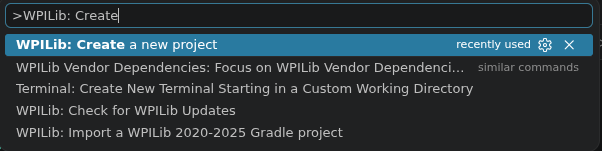
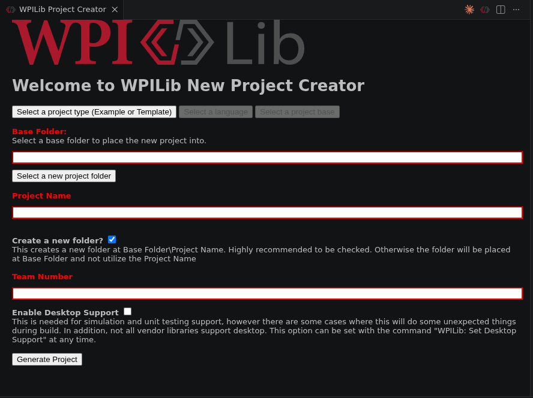

# Your First Robot Project

## Making a project
Robot code doesn't fit in one `Game.java`. A robot program has many files, plus extra files that tell WPILib how to build and run it, all in one folder called a **project**. WPILib VS Code can create a new project with all of that set up:
1. Press **Ctrl+Shift+P** to open the **command palette**, a search box for everything VS Code can do.
2. Type `WPILib: Create a new project` and click it when it appears.

   

   A page called **WPILib New Project Creator** opens:

   

3. Click the three buttons across the top one at a time. Each opens a list at the top of the VS Code window:
   - **Select a project type (Example or Template)**: pick **Template**.
   - **Select a language**: pick **Java**.
   - **Select a project base**: pick **Command v3 Robot**. (Not **Command v3 Robot Skeleton (Advanced)**.)
4. Under **Base Folder**, click **Select a new project folder** and choose your `Documents` folder. For **Project Name**, type `ArmRobot`. Make sure **Create a new folder?** is checked.
5. For **Team Number**, type our team's number.
6. Check **Enable Desktop Support**. This is what lets your code run in the simulator on your laptop, so don't skip it.
7. Click **Generate Project**. When VS Code asks whether to open the new project, say yes.

The first time a project opens, VS Code can take a minute or two to get it ready. Its progress shows in the bottom-right corner.

## What's in a project
The left side of VS Code now shows a lot of files. Most of them, like `build.gradle`, are for WPILib, telling it how to build your code and send it to the robot. You won't need to change them. Our code all lives in `src/main/java/frc/robot`:
```
frc/robot/
	Main.java
	Robot.java
	ExampleTeleop.java
	ExampleAuto.java
	constants/
		DriverConstants.java
		ExampleConstants.java
	mechanisms/
		ExampleMechanism.java
```


Each class has its own file named after it, as in our game. There are a lot more of them, so they're sorted into folders.

### Packages
Look at the first line of `Robot.java`. (A few comment lines about the license may come first. You can skip those.)
```java
package frc.robot;
```
This is a **package**, from [Lists](ch01-19-lists.md). Java keeps its own classes in packages like `java.util`, and your code lives in packages too. A package is a folder: `Robot.java` is in the `frc/robot` folder, so it's in the `frc.robot` package. `DriverConstants.java` is in `frc/robot/constants`, so its first line is `package frc.robot.constants;`. Every file starts by naming its package, and the name always has to match the file's folder.

A class that uses a class from another package needs an `import`, like `ArrayList` did. That's why `Robot.java` has lines like these:
```java
import frc.robot.constants.DriverConstants;
import frc.robot.mechanisms.ExampleMechanism;
```
Also from [Lists](ch01-19-lists.md): with no `public` or `private`, only code in the same package can use something. That's about to matter.

### Main.java
`Main.java` is where the program starts, like the `main` in our game:
```java
public final class Main {
	private Main() {}

	public static void main(String... args) {
		RobotBase.startRobot(Robot::new);
	}
}
```
`Main` is `final`, like our constants classes, so nothing can extend it. `private Main() {}` is a `private` constructor, so no other class can make a `Main` object. Nothing ever needs one, since `main` is `static` and Java calls it without an object.
`String...` is another way to write `String[]`. `Robot::new` is a method reference, like the ones in [Lambdas](ch01-16-lambdas.md), to `Robot`'s constructor. It means "a lambda that makes a new `Robot`." So `main` gives WPILib a way to make our robot, and WPILib handles the rest.
You'll never need to change `Main.java`. All our code goes in the other files.

## Robot.java
`Robot` is the class for the whole robot:
```java
public class Robot extends OpModeRobot {
	final ExampleMechanism exampleMechanism = new ExampleMechanism();
	final CommandGamepad exampleController =
			new CommandGamepad(DriverConstants.DRIVER_CONTROLLER_PORT);

	public Robot() {}

	@Override
	public void robotPeriodic() {
		Scheduler.getDefault().run();
	}
}
```
Almost all of this should look familiar:
- `Robot extends OpModeRobot`, as in [Inheritance](ch01-11-inheritance.md). WPILib's `OpModeRobot` does all the work of starting up and running the robot.
- The fields are the robot's parts. Here there's one mechanism and one controller for the driver. (A **mechanism** is a part of the robot that moves, like an arm or the wheels.) The controller plugs into the Driver Station laptop at the port number in `DriverConstants`.
- The fields are `final` because the robot keeps the same parts forever. They aren't `private`, so other classes in the `frc.robot` package can use them. The reason comes up shortly.
- `robotPeriodic()` overrides `OpModeRobot`'s version, and WPILib calls it about 50 times a second. It runs the **scheduler**, the part of WPILib that runs commands. On each call to `run()`, every running command gets one turn, lasting until it calls `coroutine.yield()`, as in [Loops](ch01-18-loops.md).

## Opmodes
Next, open `ExampleTeleop.java`:
```java
@Teleop
public class ExampleTeleop implements OpMode {
	public ExampleTeleop(Robot robot) {
		robot.exampleController.rightStick().whileTrue(robot.exampleMechanism.exampleCommand());
	}
}
```
An **opmode** is one way of running the robot. A robot can have many: one for driving in matches, one for practice, several autonomous routines. Before a match, the drivers choose a teleop opmode and an autonomous opmode from drop-down lists in the Driver Station.
- `@Teleop` is an **annotation**, like `@Override`. It's a label telling WPILib "this class is a teleop opmode, so put it in the teleop list." `ExampleAuto.java` has `@Autonomous` instead, which puts it in the autonomous list. You never build a list of opmodes yourself, because WPILib finds every class with one of these labels.
- `implements OpMode` promises that this class is an opmode.
- The constructor is handed the `Robot`, so the opmode can use its parts. This is why `Robot`'s fields aren't `private`. `ExampleTeleop` is in the same package, so it can reach `robot.exampleController` and `robot.exampleMechanism`.
- WPILib makes the opmode, by calling this constructor, as soon as the drivers pick it from the list.

The constructor is one line, but it does a lot. It's a trigger binding, like the triggers in [Lambdas](ch01-16-lambdas.md). `rightStick()` is a `Trigger` that's true whenever the driver presses down on the controller's right stick. `whileTrue(...)` runs a command for as long as that trigger stays true. Together, the line says "while the right stick is pressed down, run the example command."

## Mechanisms
Last, open `mechanisms/ExampleMechanism.java`:
```java
public class ExampleMechanism implements Mechanism {
	public final Trigger exampleCondition = new Trigger(() -> false);

	public Command exampleCommand() {
		return run(coroutine -> {
			int runCount = 0;
			while (true) {
				runCount++;
				System.out.println("Example command run #" + runCount);
				coroutine.yield();
			}
		}).named("Example Command");
	}
}
```
- `implements Mechanism` promises that this class is a mechanism. `Mechanism` is a WPILib interface with default versions of all its methods, so `ExampleMechanism` doesn't have to write any of them.
- `exampleCondition` is a trigger whose condition is always `false`, so it never does anything. It's there to show how to make one.
- `exampleCommand()` makes a `Command` and returns it.

`run(...)` is one of the methods `ExampleMechanism` gets from `Mechanism`. It makes a command that belongs to this mechanism, and the lambda is what the command does. `coroutine` is the command's coroutine, which is how the command talks to the scheduler. Every command needs a name, and `.named(...)` gives it one. Leave it off and your code won't build.

This command counts up forever, printing a message each time around. Because it calls `coroutine.yield()` every time, it only goes around once per scheduler run, about 50 times a second, and the rest of the robot keeps running.

{{#quiz ../quizzes/ch02-01-project.toml}}

## Running it
To run it in the simulator:
1. Open the command palette with **Ctrl+Shift+P** and pick `WPILib: Simulate Robot Code`.

   

2. WPILib asks which simulation extensions to use. **Sim GUI** should already be checked, so click **OK**.

   

3. After a short wait, a window called the **Sim GUI** opens. It's a pretend Driver Station.

   

The Sim GUI has many small windows inside it. The ones that matter for now:
- **Robot State** has buttons for **Disabled**, **Autonomous**, **Teleoperated** and **Utility**. Clicking any of the last three enables the robot in that mode, and clicking **Disabled** disables it again. Commands only run while the robot is enabled.
- Below them is an **OpMode** drop-down. It's the same list the drivers choose from.
- **System Joysticks** lists every controller plugged into your laptop, and **Joysticks** has numbered slots for the robot's controllers. Drag a controller from **System Joysticks** into the slot with the same number as `DRIVER_CONTROLLER_PORT`. (No game controller? The keyboard can stand in for one. It shows up as **Keyboard 0**.)


Now choose **Teleoperated**, pick `ExampleTeleop` from the **OpMode** list, and press down on the controller's right stick. VS Code's terminal shows:
```
Example command run #1
Example command run #2
Example command run #3
```
and keeps going at about 50 lines a second for as long as you hold the stick. Let go and it stops, because `whileTrue` cancels the command as soon as the trigger turns false.
To stop the simulation, close the Sim GUI window.

{{#quiz ../quizzes/ch02-01-running.toml}}

## Try it yourself
Add a second command to `ExampleMechanism` called `sayHello`. It should print `Hello, robot!` once and then finish. Then, in `ExampleTeleop`, make it run once each time the driver presses the bottom face button on the controller, which is `faceDown()`. (WPILib names the face buttons by position, so the same code works on any kind of controller.)

*Hint: what keeps `exampleCommand` going forever? Your command shouldn't do that. For the binding, think back to the [Lambdas](ch01-16-lambdas.md) exercise. Which kind of trigger runs something once, at the moment it becomes true?*

Run the simulator again and press the button a few times. You should see `Hello, robot!` once per press, however long you hold the button.

<details>
<summary>Answer</summary>

Here's one way to do it. In `ExampleMechanism`:
```java
public Command sayHello() {
	return run(coroutine -> {
		System.out.println("Hello, robot!");
	}).named("Say Hello");
}
```
And in `ExampleTeleop`'s constructor:
```java
robot.exampleController.faceDown().onTrue(robot.exampleMechanism.sayHello());
```
`sayHello` has no loop, so the command is done as soon as its lambda reaches the end. It never needs `coroutine.yield()`, because it finishes right away.
`onTrue` starts the command at the moment the trigger becomes true, when the button goes down. Holding the button doesn't start it again. `whileTrue` would also start it, but it's meant for commands that run until you let go.

</details>
